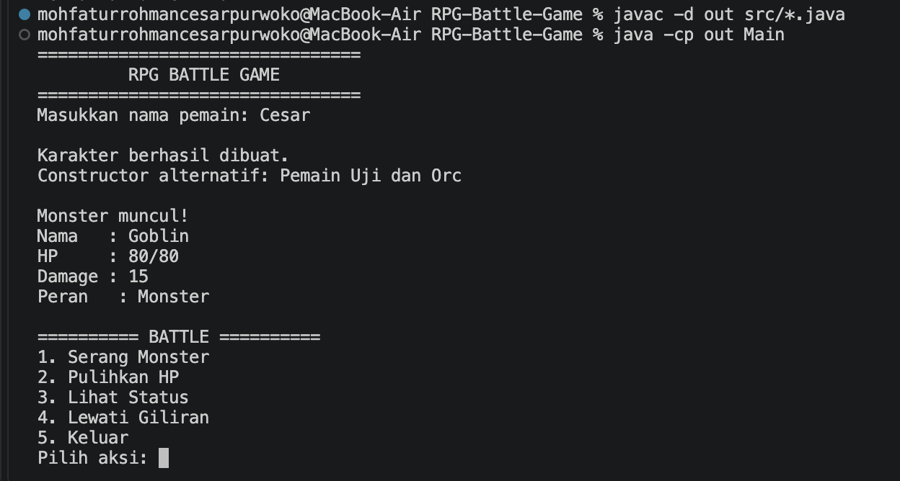
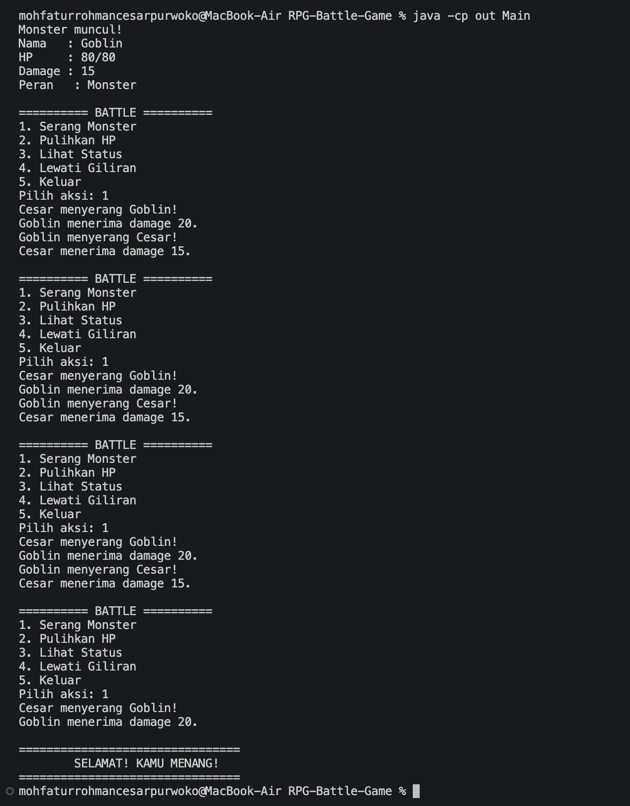
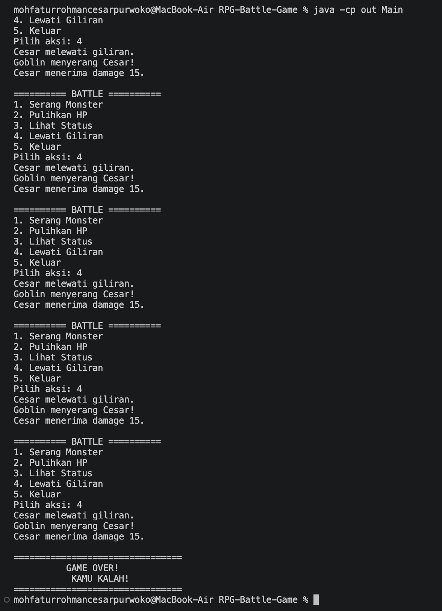
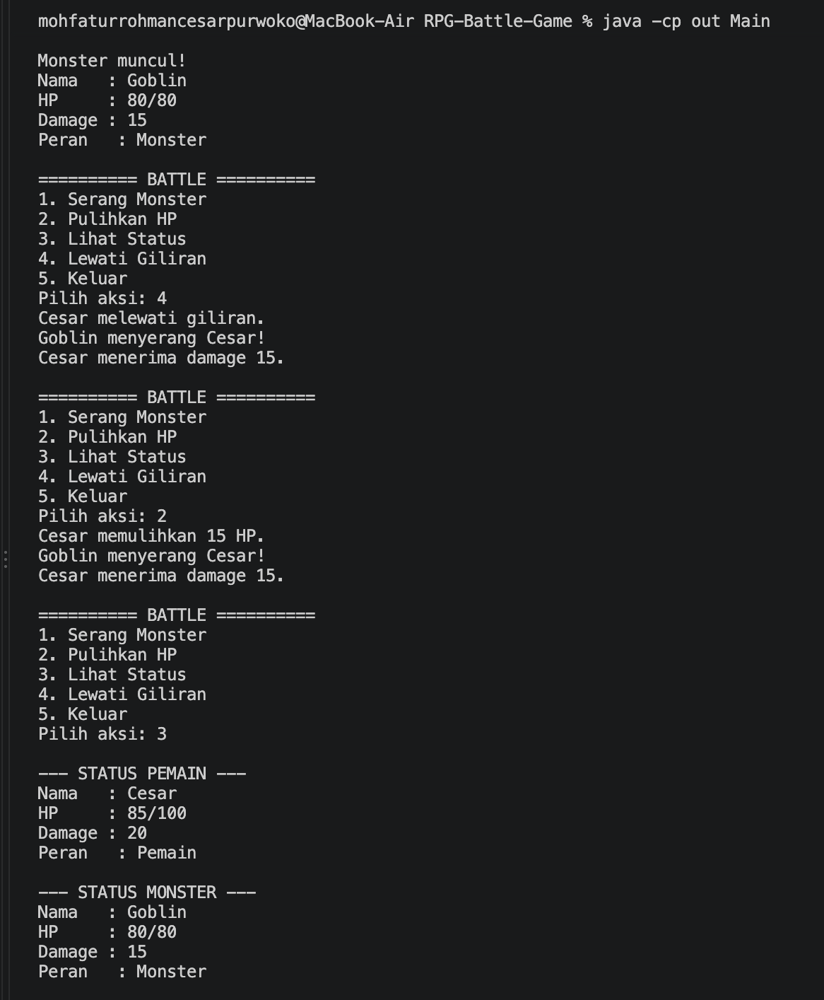

# RPG Battle Game

RPG Battle Game adalah permainan pertarungan sederhana berbasis terminal yang dibuat menggunakan Java untuk memenuhi Responsi Akhir Praktikum Pemrograman Berorientasi Objek. Pemain bertarung melawan monster dengan memilih aksi menyerang, memulihkan HP, melihat status, atau melewati giliran.

## Identitas Mahasiswa

| Keterangan | Identitas |
|---|---|
| Nama | Fatur Cesar |
| NIM | H1D025150 |
| Program Studi | Informatika |
| Fakultas | Teknik |
| Universitas | Universitas Jenderal Soedirman |
| Tema berdasarkan digit terakhir NIM | Game (0) |

## Fitur Program

- Membuat karakter pemain dan monster.
- Menyerang monster dan menerima serangan balasan.
- Memulihkan HP pemain.
- Melihat status HP dan damage karakter.
- Melewati giliran dan mengakhiri permainan saat pemain memilih keluar.
- Menampilkan hasil menang atau kalah.

## Struktur Project

```text
RPG-Battle-Game/
├── src/
│   ├── Attackable.java
│   ├── GameCharacter.java
│   ├── GameConfig.java
│   ├── Healable.java
│   ├── Main.java
│   ├── Monster.java
│   └── Player.java
├── screenshots/
├── .gitignore
└── README.md
```

## Cara Compile dan Menjalankan Program

Pastikan JDK sudah terpasang. Buka terminal pada folder utama project, lalu jalankan:

**Compile seluruh source code:**

```bash
javac -d out src/*.java
```

**Jalankan program:**

```bash
java -cp out Main
```

Masukkan nama pemain, kemudian pilih menu yang tersedia. Pilihan 1 untuk menyerang, 2 untuk memulihkan HP, 3 untuk melihat status, 4 untuk melewati giliran, dan 5 untuk keluar.

## Screenshot Luaran Program

Tambahkan atau perbarui screenshot setelah menjalankan versi final program berikut:

### Tampilan awal dan pertarungan



### Pemain menang



### Pemain kalah



### Pemulihan HP

